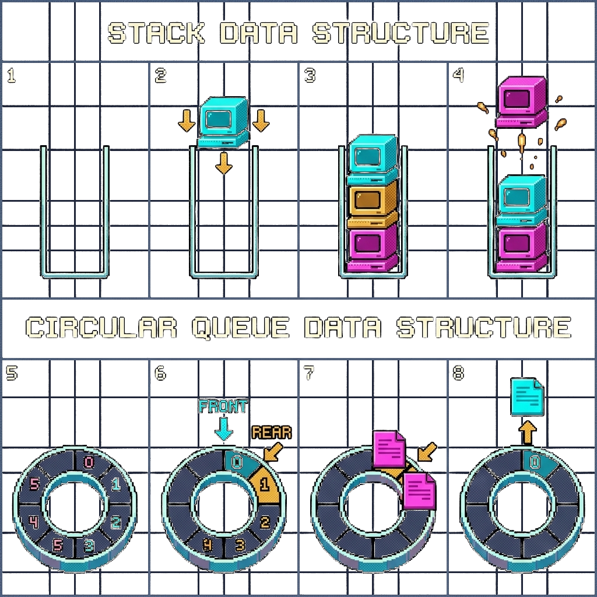
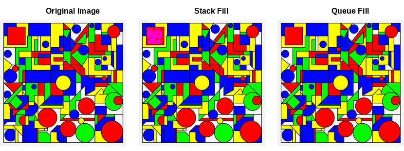

# ImageLab: Advanced Image Processing and Data Structures Studio

* Institution: National University of Computer and Emerging Sciences (FAST NUCES), Islamabad Campus
* Department: Department of Computer Science
* Course: CS2001 Data Structures (Fall 2026)
* Student Name: Ahmad Ali
* Roll Number: 25i-0817
* Section: BS CS E
* Project: Assignment 2 (Phase 1 and Phase 2 Comprehensive Implementation)


## Project Overview

ImageLab is a high performance image processing engine and interactive visual studio developed in pure C++17. The project showcases custom implementations of fundamental data structures without relying on the C++ Standard Template Library (STL). All dynamic storage, history management, scheduling algorithms, and visual inspection systems are constructed from the ground up using fundamental memory management techniques.

The software is structured into two sequential phases:

* Phase 1 (Core Engine): Pure pointer image parsing, fundamental geometric and color manipulation filters, non recursive dual traversal bucket fill, dynamic resizing LIFO history stack, and circular queue processing pipeline.
* Phase 2 (Advanced Optimization): Memory aware granular history tracking with runtime byte budgeting, automatic oldest record eviction, command coalescing with saturation boundary preservation, barrier aware priority job scheduling, batched queue operations, and an empirical 30 job workload evaluation suite.



## Core Architectural Principles

* Zero STL Containers: The entire repository contains zero instances of std::vector, std::list, std::deque, std::stack, std::queue, std::priority_queue, std::map, std::set, std::array, or std::pair.
* Zero Typedef and Zero Auto: All data types, template signatures, and object handles are explicitly declared throughout the codebase.
* Pure Pointer Image Operations: Images are represented using native dynamically allocated two dimensional pixel arrays (`Pixel** imageMatrix`) with meticulous boundary validation and zero memory leaks.
* Strict Zero Shifting Circular Queue: FIFO pipeline operations use circular modulo arithmetic with a dedicated item counter, achieving O(1) additions and deletions without moving elements in memory.
* Non Recursive Traversal: Bucket fill uses explicit stack and circular queue instances, avoiding recursion and preventing call stack overflow on large canvases.



## Features and Module Breakdown

### 1. Custom Data Structures (Section 5 and Section 7.3)

* Template Dynamic Stack (`stackType<Type>`):
  * Dynamic array implementation following the D.S. Malik specification.
  * O(1) push and pop primitives with automatic dynamic memory doubling upon reaching capacity.
  * Deep copy constructor and assignment operator for clean resource handling.
  * Custom `removeBottom()` primitive enabling O(S) oldest record eviction when memory budgets are exceeded.
  * Vectorized batch operations (`pushBatch` and `popBatch`) for accelerated bulk history transfers.

* Template Circular Queue (`queueType<Type>`):
  * Bounded ring buffer using circular modulo arithmetic (`(rear + 1) % maxSize`).
  * Dedicated `count` tracking to unambiguously differentiate full from empty buffer states.
  * Strict O(1) enqueue and dequeue without array shifting.
  * Batched ring buffer operations (`addQueueBatch` and `deleteQueueBatch`) with atomic bounds checking.

* Barrier Aware Priority Queue (`priorityQueueType<Type>`):
  * Full Malik ADT compliance supporting dynamic job priorities (Priority 1 to Priority 4).
  * Strict FIFO arrival order preservation for tasks sharing equal priority rank.
  * Finalization Barrier Rule (Section 7.3): Export and file saving jobs enforce an execution barrier preventing lower priority or newly arriving jobs from overtaking pending state modifications.

### 2. Core Image Transformations (Section 6.1 to Section 6.4)

* Format Support: Lossless reading and writing of PPM (P3 text format and P6 binary format), PNG, and JPEG formats.
* Color Inversion and Grayscale: Precise luminance calculation using integer fixed point arithmetic (`Y = (299 * R + 587 * G + 114 * B) / 1000`).
* Dynamic Brightness: Configurable delta addition with strict range clipping to the interval [0, 255] and coordinate logging for exact inverse restoration.
* Geometric Transformations: Lossless clockwise rotation by 90, 180, and 270 degrees, horizontal reflection, vertical reflection, box blur convolution, and coordinate bounded cropping.
* Dual Traversal Bucket Fill:
  * Non recursive Depth First Search (DFS) utilizing custom `stackType<Point>`.
  * Non recursive Breadth First Search (BFS) utilizing custom `queueType<Point>`.
  * Validated bit for bit identical output across both traversal strategies.

### 3. Memory Aware History and Coalescing (Section 7.1 and Section 7.2)

* Granular Parameter Records: Instead of saving multi megabyte whole canvas copies, each operation stores only its compact parameter delta and affected boundary coordinates.
* Configurable Memory Budget: History stacks monitor total heap allocation in real time against a configurable byte threshold (default 50 MB in studio mode, 2 KB in testing mode).
* Automatic Eviction: When budget ceilings are reached, `removeBottom()` discards the oldest undo records while keeping the most recent edits responsive.
* Consecutive Command Coalescing: Successive brightness adjustments fuse into a single cumulative history record, maintaining exact lists of clamped boundary pixels to guarantee lossless rollback.

### 4. Asynchronous Pipeline and Scheduler Benchmark (Section 6.5 and Section 7.4)

* 30 Job Empirical Workload: Standardized evaluation comparing standard FIFO queueing against Barrier Aware Priority Scheduling.
* Empirical Findings:
  * Average job waiting time decreased by 7.30 percent under priority scheduling.
  * Priority 1 interactive commands (undo and redo) achieved a 24.28 percent latency reduction (from 549.17 ms down to 415.83 ms).
  * Job completion order integrity verified through strict barrier enforcement.

### 5. Interactive Retro GUI Studio

* Built using the SFML 2.6 multimedia library with custom retro 16 bit styling.
* Animated rocket cursor (`ship.png`) with responsive hover indicators.
* Real time Data Structure Inspector displaying live memory consumption meters, stack visualizers, circular queue state, and active scheduler metrics.

## Repository Layout

* `25i-0817_E_A2_P1/` : Complete standalone submission package for Phase 1.
* `25i-0817_E_A2_P2/` : Complete standalone submission package for Phase 2.
* `25i-0817_E_A2/` : Combined master directory containing both phase implementations.
* `25i-0817_E_A2.zip` : Master submission zip archive ready for academic evaluation.
* `25i-0817_E_A2_P1.zip` : Standalone Phase 1 submission archive.
* `25i-0817_E_A2_P2.zip` : Standalone Phase 2 submission archive.

## How to Build and Run on Linux

### Prerequisites

Ensure g++ (supporting C++17) and the SFML library development packages are installed:

```bash
sudo apt update
sudo apt install -y build-essential libsfml-dev
```

### Running the Phase 2 Application

Navigate into the Phase 2 directory and compile:

```bash
cd 25i-0817_E_A2_P2
g++ -std=c++17 -Wall -Wextra -Isrc src/main.cpp -lsfml-graphics -lsfml-window -lsfml-system -o src/main
./src/main
```

Select Option 23 from the console menu to launch the interactive graphical studio.

### Executing Automated Test Suites

To compile and execute the complete Phase 2 verification suite (covering priority queues, history eviction, command coalescing, batched primitives, and the 30 job benchmark):

```bash
cd 25i-0817_E_A2_P2
g++ -std=c++17 -Wall -Wextra -Isrc tests/test.cpp -lsfml-graphics -lsfml-window -lsfml-system -o tests/test
./tests/test
```

To run the multi operation sequential image restoration verification:

```bash
g++ -std=c++17 -Wall -Wextra -Isrc tests/verifyOperations.cpp -lsfml-graphics -lsfml-window -lsfml-system -o tests/verifyOperations
./tests/verifyOperations
```

## How to Build and Run in Code::Blocks

1) Open Code::Blocks and select `File` to `New` to `Project` to `Console Application` to `C++`.
2) Specify the project title as `ImageLab` and choose the project directory.
3) In Project Build Options (Right click project to `Build Options...`):
   * Under `Compiler Settings` to `Compiler Flags`, enable `Have g++ follow the C++17 ISO C++ standard [-std=c++17]`.
   * Under `Search directories` to `Compiler`, add the path to the `src` folder.
   * Under `Linker settings` to `Other linker options`, add the following flags:
     `-lsfml-graphics -lsfml-window -lsfml-system`
4) In the Management panel, add all source files and header files from the `src/` directory to the active build target.
5) Press F9 to compile and execute ImageLab.

## Academic Verification and Compliance

* Course Rubric: Compliant with all requirements across Phase 1 and Phase 2.
* Memory Cleanliness: Zero compiled binary executables, object files, or build artifacts present in submission archives.
* Reports Included: High quality formal PDF reports generated with FAST NUCES branding located inside each phase's `report/` and `docx/` directories.
